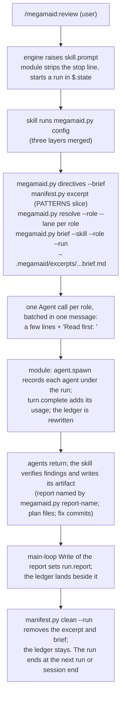

# Overview

megamaid is a Claude Code plugin with two halves. The prose half (`skills/`, `shared/`, `agents/`, `directives/`) tells the session's model what to do; the code half (`hooks/`) runs inside the engine and strips, records and writes. Two stdlib Python scripts, `megamaid.py` and `manifest.py`, do the bookkeeping the prose contracts specify, so no orchestrating model re-derives it. The contract is skills + shared + hooks; [CHANGELOG.md](../../CHANGELOG.md) records every change to it.

## Where things live

| Directory | What it holds | Main gates |
|---|---|---|
| `skills/*/SKILL.md` | Eight commands: review, plan, fix, vacu-suck, patterns, configure, help, fix-auto (model-only). The prose contract. Every skill but help opens with the stop line. | `evals/` cases; check-contract §3, §4, §5, §9, §11 |
| `shared/*.md` | Eleven blocks the skills and agents read by `${CLAUDE_PLUGIN_ROOT}` path: config loading, directive matching, dispatch delivery, manifest slicing, the three role briefs, migration, scan and shave rules. | check-contract §2, §3 |
| `agents/*.md` | Nine agents: five read-only reviewers, planner, implementer, pattern-scanner, pattern-shaver. Tool limits are frontmatter `disallowedTools`. | check-contract §8 |
| `directives/*.md` | Eight shipped review directives, read by agents by path. | check-contract §1 |
| `config/defaults.json` | Every config key with its default: paths, directives, agents, fix, models. Keys: [config.md](../api/config.md). | check-contract §8, §9; fixture copy compared |
| `scripts/` | `megamaid.py` (config merge, role resolution, directives, briefs, report names, batches, findings, migration), `manifest.py` (PATTERNS excerpts and shave), `migrate.py` (the forked-from names, loaded by path), `replay-graders.py`, the gates. CLIs: [scripts.md](../api/scripts.md). | `scripts/test-*.sh` against `scripts/fixtures/` |
| `hooks/` | `hooks.json` names `register.ts`; it wires `skill-prompt.ts`, `read-note.ts`, `agents.ts`, `usage.ts`, `session.ts`. Pure helpers without `$`: `run.ts`, `ledger.ts`, `stop-line.ts`. See [hooks-module.md](hooks-module.md). | `hooks/*.test.ts` with `test-rig.ts`, run by `claude plugin test`; `tsc` |
| `types/index.d.ts` | `PluginState.megamaid.run`, the one state slot. | `tsc` |
| `vendor/claude-code-types/` | The pinned engine types `tsc` and CI build against; refreshed by `scripts/sync-types.sh`. | check-contract §12 (version), `test-sync-types.sh` |
| `evals/` | Nine behavioral cases for `claude plugin eval`. [evals/README.md](../../evals/README.md). | the eval suite |
| `experiments/` | Four two-arm cases that ask whether a prompt passage still earns its tokens. [experiments/README.md](../../experiments/README.md). | run by hand |
| `.claude-plugin/plugin.json` | Name, version, `types` pointer. | check-contract §6 |
| `.github/workflows/ci.yml` | The free gates on push to main, PRs and dispatch; the paid suite on dispatch. | — |
| `CHANGELOG.md` | The contract's history, Keep a Changelog form. | README Status line links it (§6) |

The repo's own docs: [docs/INDEX.md](../INDEX.md); process in [dev-flow.md](../process/dev-flow.md); state in [handover/main.md](../handover/main.md).

## How a command runs

Skills run in the session's model; agents get model and effort from config at each dispatch.

Plan and fix follow the same shape with their lanes; patterns dispatches the briefless scanner and shaver; vacu-suck and fix-auto Read the sub-skill files and run them in place (the module adds a note that the stop line does not apply). What each command does for its user: [features](../features/review.md). Working files: [working-paths.md](../api/working-paths.md).

## The contract

- `skills/*/SKILL.md`, `shared/*.md` and `hooks/` define the behaviour; every change to them gets a CHANGELOG entry and a version bump at release.
- `scripts/` implement prose contracts deterministically (`megamaid.py` names the shared blocks it implements in its docstring); a script and its fixtures change together.
- `config/defaults.json` is the user-facing surface for what can vary; a correctness property has no key there.
- The stop line in every skill but help is the only text copied between files; check-contract §11 keeps the copies equal to `hooks/stop-line.ts`.
