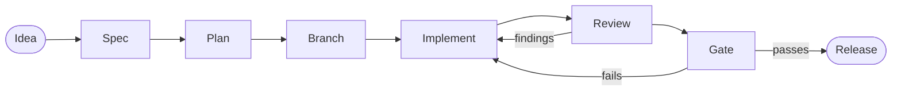

# Development flow

How a change goes from an idea to a release, and the rules every session keeps. Role: [main](../handover/main.md), the one session that specs, plans, implements, releases and spawns reviewer and implementer subagents. The maintainer (@olioskar) owns every decision.

The bar: an internal tool until the first public release (MM-029, First public release); no users yet; installs with `--plugin-dir` only. A behaviour the pipeline promises is gated by a test, a contract check or an eval case; nothing else is.

## Setup

A clean machine to working gates. Each line's check must pass before the next. The first `npx` run needs network.

| Step | Command | Check (what a pass looks like) |
|---|---|---|
| git | any install | `git --version` prints a version |
| node (with npm, npx) | any install | `node --version` prints a version |
| python3 3.8 or later | any install | `python3 --version` prints 3.8 or later |
| Claude Code with hooks modules | `npm install -g @anthropic-ai/claude-code@<version>`, the version named on line 1 of `vendor/claude-code-types/claude-code/index.d.ts` | `claude --version` prints that version; another version makes `check-contract.sh` print `WARN` locally and `FAIL` in CI |
| Load the plugin | `claude --plugin-dir .` | `/megamaid:help` answers without `MEGAMAID-MODULE-NOT-LOADED` |
| Manifest | `claude plugin validate .` | Prints `Validation passed with warnings` (the accepted warning: [gates](../architecture/gates.md)) |
| Module tests | `claude plugin test .` | Prints `N pass` and `0 fail`, N at least `MIN_TESTS` in `scripts/check-contract.sh` |
| Contract | `scripts/check-contract.sh` (runs the script fixtures, `tsc` and `claude plugin test`) | Ends with `check-contract: OK` |

What each gate checks: [gates](../architecture/gates.md). Design rules every change keeps: [design rules](../architecture/design-rules.md).

## Steps

| Step | Who | What | Done when |
|---|---|---|---|
| 1. Idea | Maintainer; any session may propose | An ask, or an item in `issues.yaml` | The maintainer says to build it |
| 2. Spec | main writes; a fresh subagent reviews it (contract lens) | `docs/specs/YYYY-MM-DD-name.md`: the parts to build, their bound, and what done looks like. Small fixes skip this step | Findings settled; maintainer's go |
| 3. Plan | main writes; a fresh subagent reviews it | `docs/specs/YYYY-MM-DD-name-plan.md` beside the spec: one task per commit, each task's test or check written first and seen to fail. Small fixes skip this step | Approved plan + "go" authorizes the per-task commits; the commit policy is confirmed once, then not asked again |
| 4. Branch | main | A branch per piece of work. `main` changes only through a PR | Branch exists; a spec or a one-line ask names the work |
| 5. Implement | main; implementer subagents edit, main commits | One commit per task, `type(scope): summary`. A deviation from the plan is written into the plan file with its reason | Each task's check passes |
| 6. Review | A fresh subagent per lens on the strongest available model: contract; code and tests | The built branch, briefed with the files, not with conclusions. Never review the plugin with its own commands. Critical and Important findings fixed, each proven by a check that failed first; Minor fixed or recorded in `issues.yaml` | The reviewer re-checks its own findings and has none open |
| 7. Gate | main | The free gates (Setup table); the paid runs per the cadence below, each on the maintainer's word. A runner failing outside the plugin (sandbox, tooling) is reported, not debugged | Free gates pass; the cadence's paid run passes or the maintainer waives it |
| 8. Release | main | `CHANGELOG.md` `[Unreleased]` → `[X.Y.Z] — YYYY-MM-DD`; `version` in `.claude-plugin/plugin.json` and the README Status line bumped together (`check-contract.sh` §6 compares them); the spec and plan folded into the docs and deleted; commit `docs(release): vX.Y.Z — <theme>`; push on the maintainer's word; open the PR; merge on the maintainer's word; `handover/main.md` "Now" and `issues.yaml` at the released state. Releases are not tagged | Merged; the tree describes the release |

## Eval cadence

The suite's canonical command and flags: [evals/README.md](../../evals/README.md). CI runs the free gates on a push to `main` and on every PR; a branch push starts nothing. The suite runs on manual dispatch.

| Situation | Run | Cost |
|---|---|---|
| Every commit | the free gates | free |
| A PR that can change behaviour, before merge | the full suite | about 5 USD |
| A change confined to one area | that case, `--case <name>` | about 1 USD |
| Once before a PR | `scripts/smoke.sh`: the free gates, help with the module on, review with it off (must stop) | about 0.25 USD |
| Prose-only edits; debugging outside the plugin | nothing | free |
| A grader that looks wrong | one `--keep-temp` run, then `python3 -I scripts/replay-graders.py evals/<case> <kept dir>` offline. Never re-run a paid case to test a grader edit | near free |
| Removing a guard passage | a two-arm run in `experiments/` | a few USD |

## Rules for every session

| Rule | Detail |
|---|---|
| Maintainer decides | Scope, gates, releases, paid runs. Quote their words; never characterise them. A reading relayed second-hand is marked as such |
| The bar | Build for failures seen or on the maintainer's ask. Unrealistic edge cases are ignored; nobody raises the bar on their own |
| Current state only | Every document says what is, in the present tense. History is git and `CHANGELOG.md` |
| Rewrite, never append | "Save progress" means: rewrite the "Now" section of `handover/main.md` and the memory file in place, then say so in one line |
| One owner per fact | A fact lives in one file; everything else points at it. A block shared across skills lives in `shared/`; a rule enforced by a hook lives in the hook |
| Briefs | A brief to a subagent states the current state it relies on, what to read first, the files it may touch, and what done means |
| Names | Items are named by what they are. An id never stands alone in a message to the maintainer |
| Verified | "Verified" is the maintainer's eye on the real thing. A machine check "passes"; a build "compiles" |
| Reviews | Every spec and every built branch goes to a fresh subagent. The writer fixes; the reviewer re-checks its own findings. A skipped review is said out loud |
| Scope | Make the change asked for. Flag other opportunities (what, where, why, how) and leave them for the maintainer |
| Commits | main stages and commits, by path: `git add PATHS && git commit -- PATHS`. Nobody pushes except on the maintainer's word |
| Unattended work | When the maintainer is away and has said to proceed, the session decides where they would, marks each such call in the spec or the report, and writes up a non-trivial behaviour change as a proposal instead of building it |
| Dangerous actions | A paid run. Say the cost first (cadence table; [costs](../knowledge/costs.md)) and take the maintainer's word per run |
| Memory | `.claude/memory/main.md`, the home named in `CLAUDE.md`: short, current, rewritten. Under 40 lines. `MEMORY.md` beside it is the engine's index, one line pointing at `main.md`. The engine finds the directory through `autoMemoryDirectory` in `.claude/settings.local.json` (untracked; set it on a new machine) |
| Sizes | `CLAUDE.md` under a dozen lines; `handover/main.md` under 80; the memory file under 40; this file under 120; the start-up read (those four) under 300. Over the line is a finding to fix, not a note to add |
| Replies to the maintainer | Short, plain, grounded. Answer what was asked; start from what they see. Argue a proposal on its merits, even against their first idea. No marketing language, and no fields, knobs or sections nobody asked for |
| Public text | PR, issue and release text is signed "On behalf of @olioskar by Claude" |
